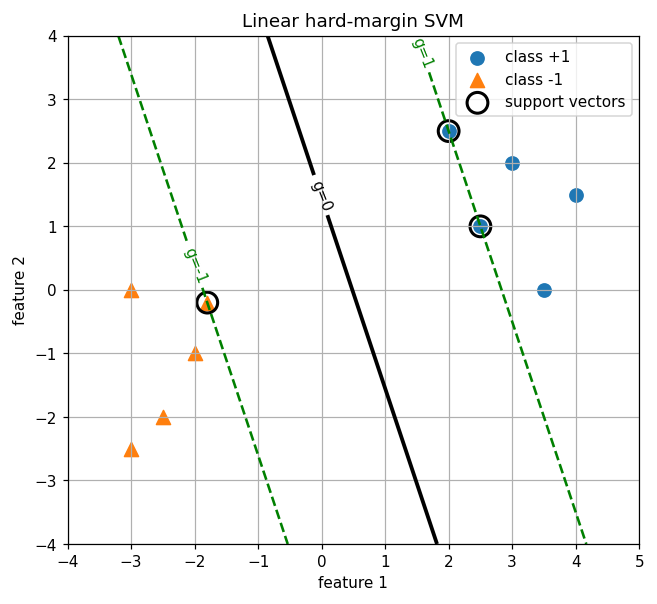

# 線形ハードマージンSVMの実装と検証

線形分離可能なデータを使い、幾何学的マージンの最大化からSVMの主問題と双対問題を導出した学習記録です。SciPyのSLSQPで双対問題を解き、ラグランジュ乗数から重みとバイアスを復元します。KKT条件を数値で検証し、決定境界とサポートベクトルを可視化します。

続編では、教材用のペア座標上昇法を自作し、双対係数の更新と決定境界の変化を追います。

| 記録 | 内容 | 実行結果付きNotebook |
| --- | --- | --- |
| 基礎編：導出と最適解の検証 | マージン、主・双対問題、SLSQP、KKT条件、線形SVCとの比較 | [基礎編Notebook](notebooks/linear_separable_svm_study_lab.ipynb) |
| [続編：学習過程を追う](learning-process.md) | 2変数更新の導出、係数と境界の推移、SLSQPとの照合 | [学習過程Notebook](notebooks/hard_margin_svm_learning_process.ipynb) |

2つのNotebookは異なる10点のデータを使用しています。以下の結果は基礎編のものです。



## 実装と確認したこと

1. **マージンの幾何** — 1次元の3点で、中央の決定境界から片側のマージン境界までの距離が2、両側の幅が4になることを確認。
2. **双対問題** — ラベル付きグラム行列 $H_{ij}=b_i b_j x_i^\top x_j$ を作り、非負制約と $\lambda^\top b=0$ のもとで双対目的関数を最適化。
3. **識別関数の復元** — $w=\sum_i\lambda_i b_i x_i$ を計算し、サポートベクトルから求めたバイアス候補を平均。
4. **最適性の検算** — 停留条件、主・双対実行可能性、相補性、双対ギャップを検証。 [点ごとの相補性の図](figures/complementary-slackness.png)
5. **別実装と比較** — 大きな $C$ を設定した scikit-learn の線形 `SVC` と、係数・バイアス・学習点の判定を照合。同じ点にパーセプトロンも適用し、境界までの最小距離を比較。

## 基礎編：2次元の実験結果

2クラス各5点の人工データを使用しました。

| 項目 | 結果 |
| --- | --- |
| サポートベクトル（1始まり、$\lambda>10^{-6}$） | 1、4、10番 |
| 重み $w$ とバイアス $w_0$ | $(0.425532, 0.141844)$、$-0.205674$ |
| 片側のマージンと両側の幅 | 2.2294、4.4588 |
| 相補性の最大絶対残差 | 約 $1.78\times10^{-8}$ |
| 主目的値と双対目的値の差 | 約 $2.44\times10^{-8}$ |
| パーセプトロンの片側マージン | 1.3741（このデータと処理順での結果） |

KKT条件の数値チェックを通過し、線形 `SVC` との係数・バイアスの差は許容誤差 $10^{-3}$ 以内でした。学習点10点の判定も一致しました。`SVC` はソフトマージンの実装なので、この比較では `C=1e5` を設定しています。

## 基礎編の実行

Python 3.9.6、NumPy 2.0.2、SciPy 1.13.1、Matplotlib 3.9.4、scikit-learn 1.6.1で全12コードセルを順に実行し、出力と図を再生成しました。基礎編Notebookのコードは添付版のままです。

```bash
cd machine-learning/linear-hard-margin-svm
python3.9 -m venv .venv
source .venv/bin/activate
python -m pip install -r requirements.txt
python -m jupyter lab notebooks/linear_separable_svm_study_lab.ipynb
```

カーネルを再起動し、上からすべてのセルを実行してください。学習データはセル内で定義しています。ハードマージンの制約は、データが厳密に線形分離可能な場合に実行可能です。

続編も同じ環境で実行できます。[学習過程の実行方法と検証結果](learning-process.md#実行と検証)を参照してください。

更新則と分離可能な場合の収束については、関連する学習記録で扱っています。 [パーセプトロンの学習記録](../perceptron/README.md)

ラグランジュ双対とKKT条件の計算は、2次元の射影問題でも確認できます。 [凸二次計画の実装と検証](../../mathematics/convex-quadratic-programming/README.md)

線形分離できないデータに対し、スラック変数を加えてマージン違反を扱う方法を続編で実装しています。 [線形ソフトマージンSVMの実装と検証](../soft-margin-svm/README.md)
