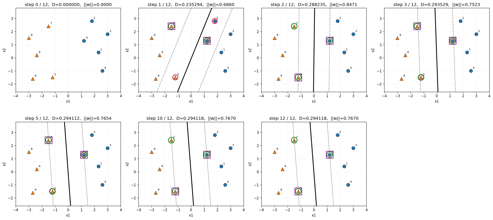
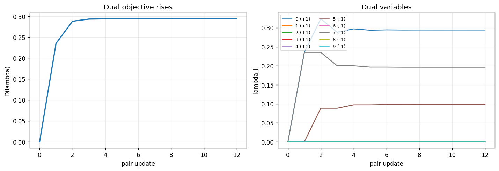
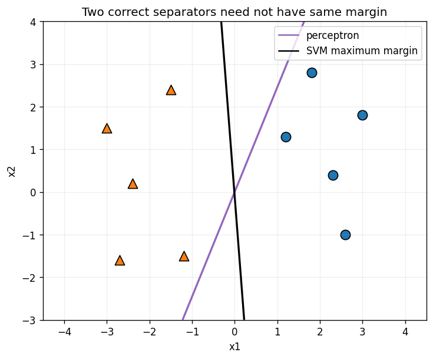

# ハードマージンSVMの学習過程を追う

線形分離可能な10点に対して、双対係数を2つずつ更新する教材用のペア座標上昇法を実装した記録です。最適解に至るまで、係数・目的関数・決定境界がどう変わるかを観察します。

[実行結果付きNotebook](notebooks/hard_margin_svm_learning_process.ipynb) / [ハードマージンSVMの学習記録へ](README.md)



## 実装・確認したこと

1. **双対問題の構成**：ラベル付きグラム行列を作り、半正定値性と双対目的関数の凹性を対応づける。
2. **2変数更新の導出**：等式制約を保つ方向を選び、非負制約を満たす範囲で目的関数を最大化する。
3. **学習履歴の記録**：各更新のペア、係数、改善量、双対目的値を保存し、任意のステップを図で確認する。
4. **独立した最適化との照合**：同じ双対問題をSciPyのSLSQPで解き、自作の更新法と比較する。
5. **最適性の数値検証**：履歴全体の双対実行可能性と、両方の最終解のKKT条件・双対ギャップを調べる。
6. **パーセプトロンとの比較**：同じデータを分離できても、境界までの最小距離が異なることを確認する。

## 更新則と制約の対応

双対問題は次のとおりです。

$$
\max_{\lambda\ge0,\;y^\top\lambda=0}
D(\lambda)=\mathbf{1}^\top\lambda-\frac12\lambda^\top H\lambda,
\qquad H_{ij}=y_i y_j x_i^\top x_j.
$$

2点 $i,j$ を選び、$d_i=1$、$d_j=-y_i/y_j$、ほかの成分を0とすると、$y^\top d=0$ になります。したがって $\lambda' = \lambda+td$ は等式制約を保ちます。

$$
D(\lambda+td)-D(\lambda)=at-\frac12qt^2,
\qquad a=\nabla D(\lambda)^\top d,\quad q=d^\top Hd.
$$

$q>0$ の場合は $a/q$ を非負制約から求めた区間に切り詰めます。コードには曲率が小さい場合の分岐もあります。各更新では全45ペアの改善量を調べ、最も改善するペアを選択します。最大改善量が $10^{-12}$ 未満になるか、更新回数の上限に達したところで停止します。

2つの係数を同時に動かす考え方はSMOと共通していますが、ペア選択・バイアス更新・停止判定を教材向けに簡略化した実装です。LIBSVMのSMO実装を再現するものではなく、大規模データ向けの効率化も扱っていません。

## 図の読み方

- **黒線**：$g(x)=0$、**灰色の破線**：$g(x)=\pm1$。
- **緑の輪**：その時点で $\lambda_k>10^{-7}$ の点。途中では、最適解のサポートベクトルとは限らない。
- **赤の輪**：表示用の境界に対して $y_k g(x_k)<1-10^{-5}$ の点。
- **紫の四角**：直前に更新した2点。

更新途中は双対変数からバイアスが一意に決まらないため、クラスごとの射影の端点から暫定バイアスを置いて描画します。最終段階では正の双対係数を持つ点からバイアスを復元します。初期状態の $w=0$ では直線を描いていません。

双対目的値が増えていても、途中の重みと暫定バイアスが主問題の全制約を満たすとは限りません。



## この10点での結果

正負5点ずつの、Notebook内で定義した固定データを使用しています。[基礎編](README.md)とは座標が異なります。

| 項目 | 結果 |
| --- | --- |
| ペア更新回数 | 12回 |
| 双対目的値：ペア更新法 / SLSQP | 0.2941176470582353 / 0.2941176470588234 |
| 両者の双対目的値の差 | 約 $5.88\times10^{-13}$ |
| SLSQPの重み $w$、バイアス $w_0$ | $(0.764706,\;0.058824)$、$0.005882$ |
| 正の双対係数を持つ点（0始まり） | 0、5、7番 |
| SLSQPの両側のマージン幅 $2/\|w\|$ | 約2.607681 |
| 全更新での等式制約の最大絶対残差 | 約 $5.55\times10^{-17}$ |

最終解の検証では、両方の方法に対して非負制約、等式制約、最小機能的マージン、相補性、主・双対目的値の差を確認しています。

| 指標 | ペア更新法 | SLSQP |
| --- | --- | --- |
| 最小機能的マージン | 0.9999990 | 0.9999999744 |
| 相補性の最大絶対残差 | 約 $3.92\times10^{-7}$ | 約 $6.65\times10^{-9}$ |
| 双対ギャップの絶対値 | 約 $5.88\times10^{-7}$ | 約 $8.57\times10^{-9}$ |

両方の最終解で、マージンの制約違反、相補性の残差、双対ギャップの絶対値は $10^{-5}$ 以内でした。近似解では丸め誤差やわずかな制約違反により主目的値と双対目的値の差が負になることがあるため、ここでは絶対値も確認しています。目的値の差が小さいことに加え、制約と残差を別々に検査しました。

[最終境界とマージンの図](figures/learning-process-final-boundary.png)

同じ10点と固定した処理順でのパーセプトロンの最小符号付き距離は約0.545366、SVMでは約1.303841でした。これはこのデータ・初期値・処理順での比較です。



## 実行と検証

2026年11月27日にPython 3.9.6、NumPy 2.0.2、SciPy 1.13.1、Matplotlib 3.9.4でコードセルを上から順に実行し、出力と図を再生成しました。

添付版の10コードセルを保持し、末尾に検証セルを1つ追加しています。全11コードセルを実行し、元のassertと追加のassertが通過しました。説明には、更新途中の緑の輪の意味と、相補性から言えることを補足しています。

追加した検証は、履歴全体の双対実行可能性・目的関数の非減少と、ペア更新法・SLSQPそれぞれの最終解の数値検証です。結果はこの10点に対するもので、一般のデータに対する収束保証を示すものではありません。

既存の `requirements.txt` を共用します。このNotebookで使うライブラリはNumPy・SciPy・Matplotlibです。

```bash
cd machine-learning/linear-hard-margin-svm
python3.9 -m venv .venv
source .venv/bin/activate
python -m pip install -r requirements.txt
python -m jupyter lab notebooks/hard_margin_svm_learning_process.ipynb
```

カーネルを再起動し、すべてのセルを上から実行します。任意の更新を見る場合は「5. ステップを1つずつ選ぶ」の `STEP` を変更してください。

## 関連する記録

- [ハードマージンSVMの基礎編](README.md)：マージンの幾何、双対問題、SVCとの照合。
- [凸二次計画・KKT条件・双対性](../../mathematics/convex-quadratic-programming/README.md)：制約付き最適化の背景。
- [パーセプトロン](../perceptron/README.md)：更新則と収束定理。
- [ソフトマージンSVM](../soft-margin-svm/README.md)：スラック変数と双対係数の上限。
