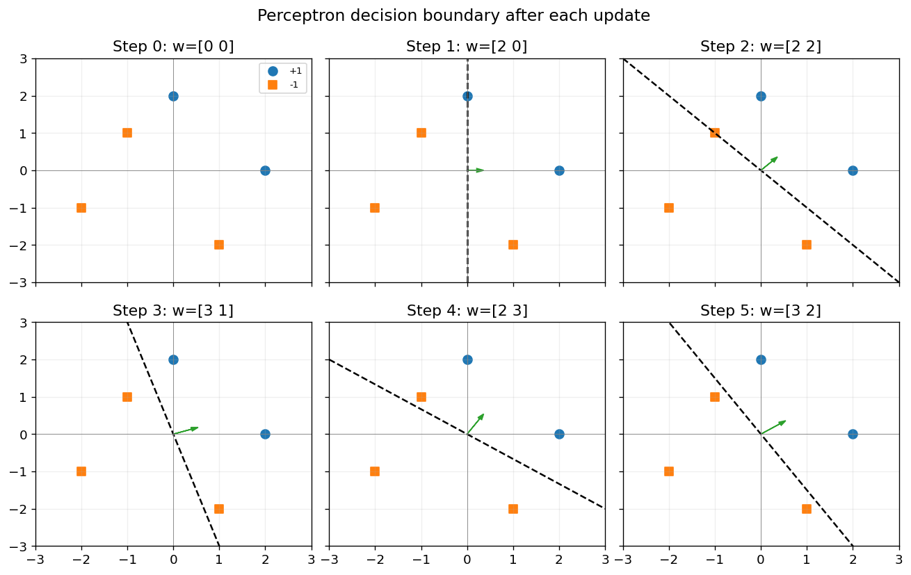

# パーセプトロンの幾何・更新則・収束

決定境界までの距離とパーセプトロンの更新則を導出し、2次元の人工データで数値と図を照合した学習記録です。5点の学習を1点ずつ追跡し、収束定理の上界と実際の更新回数を比較しました。最後に、グラム行列を使って双対形式でも同じ学習を再現しました。

[実行結果付きNotebook](notebooks/perceptron_geometry_convergence_gradient_lab.ipynb)

## 8つの実験

| 実験 | 確認したこと |
| --- | --- |
| 距離と直交射影 | 決定境界までの距離を公式・法線への射影・垂線の足から計算すると、いずれも2。係数を同じ正の定数で拡大しても距離は一定。 [図](figures/boundary-projection.png) |
| 内積と更新方向 | 更新ベクトルの長さを揃えると、対象の点でのスコア改善幅は更新方向と入力のなす角の余弦に比例する。 [図](figures/score-improvement.png) |
| 損失と勾配 | 誤分類点の解析勾配と中心差分はともに $(-2,-1)$。境界上では更新則に対応する劣勾配を選べる。 [図](figures/gradient-loss.png) |
| 学習過程 | 初期重みゼロ、切片なし、学習率1で5点を順番に処理。5回更新して重み $(3,2)$ を得て、3周目で更新がないことを確認。 |
| 収束定理 | 今回の分離方向では $R=\sqrt{5}$、$\gamma=1/\sqrt{13}$、更新回数の上界は65。各更新時の射影とノルムが証明中の不等式を満たした。 [図](figures/convergence-bound.png) |
| 固定学習率 | 初期重みゼロと同じデータ順序で、試した5つの正の学習率すべてが5回更新。重みは学習率に比例した。 |
| 線形分離できない例 | 同じ入力に反対のラベルを付けると、重みが2つの状態を往復。設定した12周の上限までに24回更新した。 [図](figures/nonseparable-updates.png) |
| 双対形式 | 線形カーネルのグラム行列 $XX^T$ を使用。全ステップのスコアが主形式と一致し、$\alpha=(1,1,2,0,1)$ から最終重み $(3,2)$ を復元。 |



図の矢印は重みベクトルです。5点は学習に使った人工データで、収束の上界はこのデータと選んだ分離方向から計算しています。

## 実行方法

Python 3.9.6、NumPy 2.0.2、Matplotlib 3.9.4で全11コードセルを順に実行し、Notebookの出力と図6枚を再生成しました。リポジトリのルートから、次の手順でNotebookを開けます。

```bash
cd machine-learning/perceptron
python3 -m venv .venv
source .venv/bin/activate
python -m pip install -r requirements.txt
python -m jupyter lab notebooks/perceptron_geometry_convergence_gradient_lab.ipynb
```

データはセル内で定義しています。掲載時に未使用のインポートを外し、初期重みゼロでの境界や、境界上の点に対する更新の説明を補足しました。

双対形式で内積をガウス型カーネルに置き換えた実験も収録しています。 [ポテンシャル関数法の学習記録](../potential-function-dual-perceptron/README.md)
