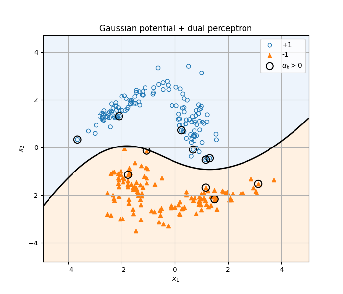
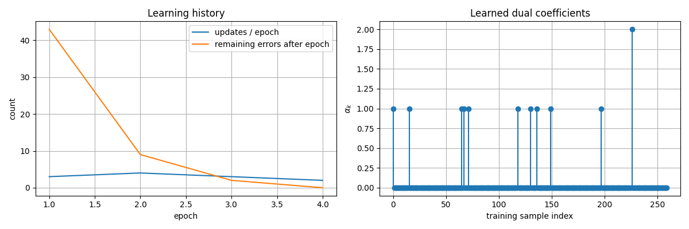
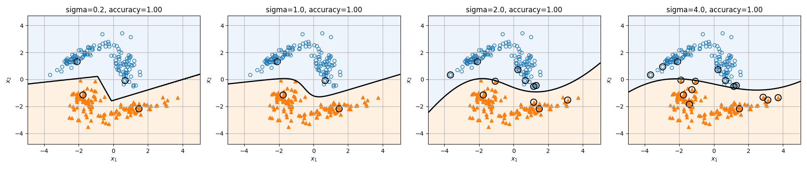

# ポテンシャル関数法を双対パーセプトロンとして実装する

『続々・わかりやすいパターン認識 線形から非線形へ』のポテンシャル関数法を学び、ガウス型ポテンシャル関数を用いた双対パーセプトロンとしてNumPyで実装した記録です。
数式とコードの対応を確認し、学習過程とカーネル幅による挙動の違いを可視化しました。

- **実装・実験**：[Notebookを読む](notebooks/potential_function_dual_perceptron.ipynb)
- **使用技術**：Python / NumPy / Matplotlib
- **関連分野**：確率分布・線形代数・カーネルを用いた非線形分類

## 主な結果

4つの正規分布から生成した2クラス・260点の人工データに対し、標準設定の $\sigma=2.0$ では4エポックで全学習点の符号付きスコアが正になりました。
更新は合計12回、最終的に識別関数に寄与する学習点は11点でした。



黒い輪で囲んだ点は $\alpha_k>0$ の学習点です。予測では、この11点からの寄与を足し合わせています。
学習データの正解率は100%ですが、独立したテストデータによる汎化性能は未評価です。

## 学習の目的と取り組んだこと

1. ポテンシャル関数・識別関数・更新則をコードに対応づける。
2. 学習によって変わる係数 $\alpha_k$ と、識別関数に寄与する学習点を確認する。
3. 学習途中の決定境界と更新履歴を可視化する。
4. $\sigma$ を変えて別々に学習し、必要な更新や決定境界の変化を比較する。

## 理論と実装の対応

### ポテンシャル関数

2点の距離に応じたガウス型の関数を使います。

$$
K(x,z)=\exp\left(-\frac{\|x-z\|^2}{2\sigma^2}\right)
$$

`gaussian_potential(A, B, sigma)`で点の組み合わせに対する値を計算します。
学習時には $G_{ij}=K(x_i,x_j)$ のグラム行列を先に計算し、各点の判定に使用します。

### 識別関数と更新則

ラベルを $b_k\in\{-1,+1\}$ とすると、識別関数は次の形です。コードではラベルを`y`で表しています。

$$
g(x)=\sum_{k=1}^{n}\alpha_k b_k K(x,x_k)
$$

係数をすべて0で初期化し、学習点 $x_k$ が $b_k g(x_k)\leq 0$ を満たすとき、 $\alpha_k\leftarrow\alpha_k+1$ と更新します。
`PotentialDualPerceptron.fit`でこの処理を実装し、`decision_function`でスコア、`predict`で分類結果を返します。

| 数式・概念 | 実装 |
| --- | --- |
| $K(x_i,x_j)$ | `gaussian_potential`とグラム行列 |
| $\alpha_k$ | `model.alpha_` |
| 誤分類・境界上の点の更新 | `y[k] * score <= 0`で係数に1を加算 |
| $g(x)$ | `decision_function` |
| 寄与ベクトル | `alpha > 0`の学習点 |
| 学習過程 | `history_`と`snapshots_` |

この実装には独立したバイアス項はありません。学習時にはスコア0の点も更新対象にし、予測時にはスコア0をクラス+1に分類します。

## 実験設定

| 項目 | 設定 |
| --- | --- |
| データ | 2次元・2クラス。各クラスが2つの正規分布の混合 |
| 平均・共分散行列 | 教科書p.27の式(2.8)〜(2.11)をもとにNotebookに記載 |
| 標本数 | 各成分65点、各クラス130点、合計260点 |
| クラス内の混合比 | 1:1と設定 |
| 乱数 | `np.random.default_rng(42)` |
| 学習順序 | 生成した4成分の順序を保ち、全エポックで固定 |
| 学習率・係数の初期値 | 1・すべて0 |
| 標準のσ | 2.0 |
| 最大エポック数 | 標準実験600、σ比較250 |
| 停止条件 | エポック終了時に全学習点で $b_k g(x_k)>0$、または最大回数に到達 |
| 評価対象 | 学習データ。テストデータとの分割は実施していない |

共分散行列は**データを生成するためのパラメータ**です。この実装で学習する対象は**係数 $\alpha_k$**であり、共分散行列を最適化するものではありません。
標本数・乱数・混合比はこの実験の設定であり、教科書の実験を完全に再現したものではありません。

## 実験結果と考察

### 学習過程と寄与する学習点



標準設定では、4エポック・12回の更新で停止しました。非ゼロの係数は11個で、そのうち1個は2、残り10個は1でした。
260点すべてを保持する学習実装ですが、予測時の計算は非ゼロ係数の点に絞っています。
Notebookでは学習途中の決定境界も示し、新しい3点について各項 $\alpha_k b_k K(x,x_k)$ の和が`decision_function`と一致することを確認しています。
この3点には正解ラベルを用意していないため、予測の計算確認として扱います。

### カーネル幅σの比較

同じ学習データを使い、各σで係数を0に戻して別々に学習しました。

| σ | エポック数 | 寄与点数 | 学習データの正解率 |
| --- | --- | --- | --- |
| 0.2 | 2 | 4 | 100% |
| 1.0 | 2 | 4 | 100% |
| 2.0 | 4 | 11 | 100% |
| 4.0 | 28 | 16 | 100% |



今回のデータと固定した学習順序では、σを2.0、4.0と大きくした際に、学習エポック数と寄与点数が増えました。
全設定で学習正解率は同じでも、決定境界の形や学習の過程は異なります。
この1回の比較だけでは、最適なσや未知データでの優劣は判断できません。

## 学んだこと・今後の課題

今回の実装を通じて確認したことは、次の3点です。

- 識別関数を、各学習点からのポテンシャルにラベルと係数を掛けた和として計算できる。
- 非ゼロになった係数を調べると、どの学習点が予測に寄与するかを追える。
- 学習正解率だけでなく、決定境界・更新履歴・寄与点数を合わせて見ると、σによる挙動の違いを捉えられる。

次に検証したいこと：

- 同じ分布から独立したテストデータを生成し、汎化性能を評価する。
- 乱数シードや学習順序を変え、更新回数・寄与点数がどの程度変わるか調べる。
- グラム行列の保存量と、予測時に非ゼロ係数の点だけを使う効果を測定する。

## 実行方法

動作確認環境はPython 3.9.6、NumPy 2.0.2、Matplotlib 3.9.4です。
Notebookを開くためのJupyterLabも`requirements.txt`に含めています。

リポジトリのルートから次を実行します。

```bash
python3 -m venv .venv
source .venv/bin/activate
python -m pip install -r machine-learning/potential-function-dual-perceptron/requirements.txt
python -m jupyter lab machine-learning/potential-function-dual-perceptron/notebooks/potential_function_dual_perceptron.ipynb
```

Windowsでは仮想環境の有効化に`.venv\Scripts\activate`を使用します。
JupyterLabでカーネルを再起動し、上からすべてのセルを実行してください。
外部データの取得は不要です。乱数シードと実験設定はNotebook内に記載しています。

READMEの3つの図はNotebookの「学習履歴」「決定境界」「σの比較」の出力を保存したものです。
設定を変えて実験した場合は、図と結果表も更新してください。

### 実行確認

9個のコードセルを新しいPythonプロセスで上から順番に実行し、結果表と図を再生成しました。
共分散行列の対称性・正定値性と、予測スコアを寄与の和として計算した値との一致も確認しています。

検証環境ではNumPyの行列積で`RuntimeWarning`が一部発生しました。
行列積を要素ごとの積と和に置き換えた別計算と照合し、4つのσすべてで学習後の係数・エポック数、および10,201点の格子上の分類結果が一致することを確認しました。
スコア差の最大絶対値は約 $5.8\times10^{-15}$ で、非有限値はありませんでした。警告の原因自体は未特定です。

## ファイル構成

```text
potential-function-dual-perceptron/
├── README.md
├── requirements.txt
├── notebooks/
│   └── potential_function_dual_perceptron.ipynb
└── figures/
    ├── decision-boundary.png
    ├── learning-history.png
    └── sigma-comparison.png
```

## 参考資料

- 石井健一郎・前田英作 著『続々・わかりやすいパターン認識 線形から非線形へ』オーム社、2022年。ISBN: 978-4-274-22947-3。[出版社の書籍紹介](https://www.ohmsha.co.jp/book/9784274229473.html)
- データ生成で参照した箇所：p.27、式(2.8)〜(2.11)。ポテンシャル関数と学習則：第4章、式(4.7)、式(4.9)〜(4.12)（ページ・式番号は学習時の参照記録）。

[機械学習の一覧へ](../README.md) / [リポジトリのトップへ](../../README.md)
