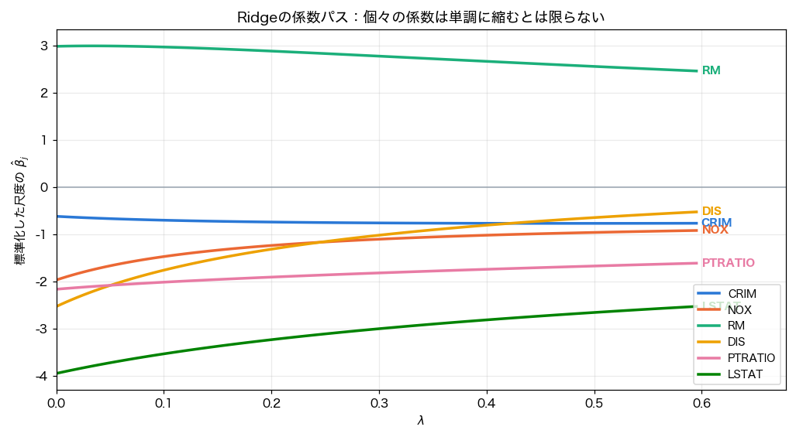
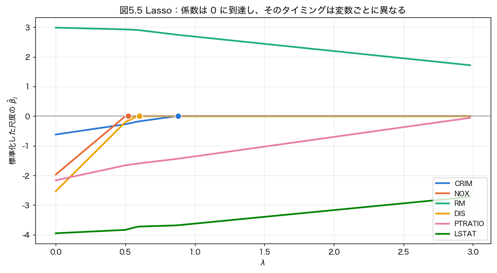
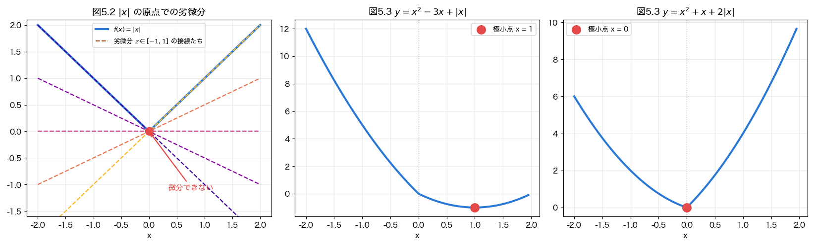
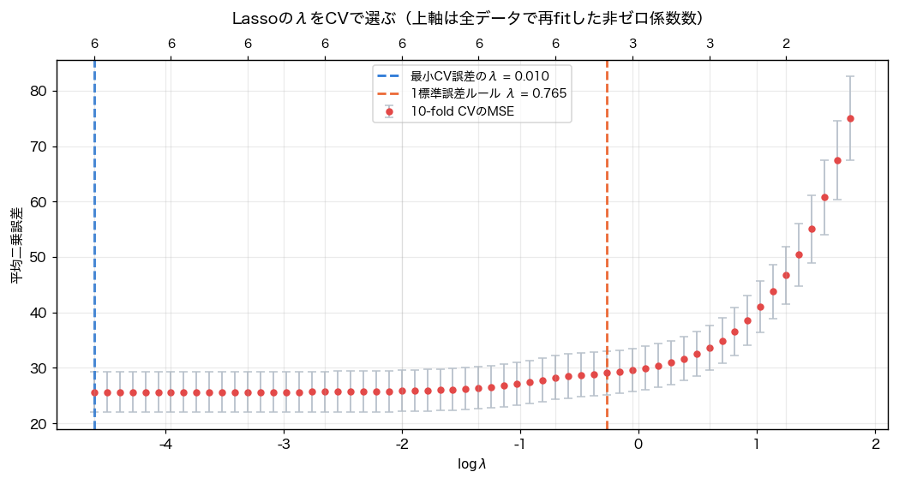

# RidgeとLasso：正則化の実装・可視化・交差検証

『統計的機械学習の数理100問 with Python』の第5章「正則化」を中心に、RidgeとLassoを数式から実装し、係数の変化と予測誤差を確かめた学習記録です。
Ridgeは連立方程式を解く形で、Lassoはソフト閾値を使う座標降下法として実装しました。
係数パス・劣微分・制約領域を図にし、交差検証によるλの選択と、人工データでのテスト評価まで行っています。

- **数式・コード・演習**：[Notebookを読む](notebooks/ridge_lasso_regularization.ipynb)
- **実験値・データ出典・実行環境**：[summary.json](results/summary.json)
- **使用技術**：Python / NumPy / pandas / Matplotlib / scikit-learn
- **前提となる数学**：[線形代数の学習記録](../../mathematics/linear-algebra/README.md)

## 学習の目的と実装内容

| テーマ | 取り組んだこと |
| --- | --- |
| Ridge | 目的関数から解を導出し、`np.linalg.solve`で実装。中心化・標準化と切片の復元も行う |
| 固有値と正則化 | 固有値に`Nλ`を加えることで正定値になる理由と、主軸ごとの縮小率を確認 |
| 劣微分 | `abs(x)`の原点での劣微分が`[-1, 1]`になることを数式と図で説明 |
| Lasso | `soft_th`と座標降下法`lasso`を実装し、scikit-learnの解と比較 |
| 係数と制約 | Ridge・Lassoの係数パス、円・ひし形の制約領域、標準化の有無を可視化 |
| ハイパーパラメータ | 学習fold内で前処理をfitする10-fold CVと、1標準誤差ルールを実装 |
| 予測と変数選択 | 疎な係数・密な係数の人工データで、独立テストのMSEと選択した変数を確認 |

## 目的関数とλの規約

切片を罰則から外し、説明変数と目的変数を中心化して考えます。このNotebookの定義は次の通りです。

$$
L_{\mathrm{Ridge}}=\frac{1}{N}\|y-X\beta\|^2+\lambda\|\beta\|_2^2
$$

$$
L_{\mathrm{Lasso}}=\frac{1}{2N}\|y-X\beta\|^2+\lambda\|\beta\|_1
$$

| 実装 | Notebookのλとの対応 |
| --- | --- |
| 自作Ridge | `(X.T @ X + N * λ * I) β = X.T @ y`を解く |
| scikit-learnのRidge | `alpha = N * λ` |
| 自作Lasso・scikit-learnのLasso | `alpha = λ` |

RidgeとLassoでは二乗誤差の係数も異なるため、数値が同じλをそのまま同じ罰則の強さとは解釈しません。
CVのRidgeでは各学習foldの標本数を使って`alpha`を設定し、全データでの再fitでは全標本数を使います。

## 係数の変化と最適化の理解

### RidgeとLassoの係数パス

| Ridge | Lasso |
| --- | --- |
|  |  |

Bostonの6変数を使った例では、Lassoのλを大きくすると、NOX・DIS・CRIMの係数が探索範囲内で0になりました。
一方、Ridgeの各係数の絶対値は単調に減るとは限りません。例えばCRIMの標準化尺度の係数は、λ=0で約-0.619、λ=0.5で約-0.768です。
個々の変数の係数と、固有ベクトル方向の縮小率を区別する必要があります。

RidgeにはLassoのように幅のある範囲で係数を0に切り落とす機構はありませんが、対称性などにより係数が厳密に0になる場合はあります。

### 劣微分とソフト閾値



`abs(x)`の原点で劣微分が区間になることから、ソフト閾値の0になる領域を説明しました。
1変数の例では、`s=0.8`、`λ=0.3`に対するソフト閾値の解0.5と、目的関数を格子上で最小化した値が一致しました。

補足の図：[ソフト閾値](figures/soft-threshold.png) / [1変数の目的関数](figures/scalar-objective.png) / [円とひし形の制約](figures/constraint-geometry.png) / [固有値ごとの縮小率](figures/eigenvalue-shrinkage.png) / [標準化の有無](figures/standardization.png)

制約領域の図に示す最小点は格子探索による近似値です。

## 交差検証によるλの選択

Bostonの506標本から、CRIM・NOX・RM・DIS・PTRATIO・LSTATの6変数を使用しました。
10分割、シャッフルあり、分割seed=0、候補λは0.01〜6.0の対数間隔60点です。
各学習foldだけで`StandardScaler`をfitし、検証foldにはその変換を適用します。



| 選び方 | λ | CVの平均MSE | 全データで再fitした非ゼロ係数数 |
| --- | ---: | ---: | ---: |
| Lasso：CV誤差最小 | 0.0100 | 25.6086 | 6 |
| Lasso：1標準誤差ルール | 0.7647 | 29.0765 | 4 |
| Ridge：CV誤差最小 | 0.0214 | 25.5812 | — |

1標準誤差ルールは、最小の平均CV誤差にその点の標準誤差を足した範囲で、最大のλを選びます。
この例では変数数が減りましたが、独立テスト上の性能が同じになる保証はありません。
Lassoの最小値は候補の下端にあるため、さらに小さいλの探索も次の検証対象です。
上のMSEは選択に使ったCVの値であり、別のテストデータで測った値ではありません。

## 人工データでのテスト評価

学習80点・特徴量60個、独立テスト400点、データ生成seed=3、誤差は標準正規分布です。
疎な設定は真の非ゼロ係数5個、密な設定は60個すべてが非ゼロです。
λは0.01〜3.0の40候補から、同じ10分割・前処理・MSE基準で選びました。テストデータはλの選択に使っていません。

| 真の係数の構造 | LassoのテストMSE | RidgeのテストMSE |
| --- | ---: | ---: |
| 疎：非ゼロ5個 | 1.2214 | 5.3252 |
| 密：全60個が非ゼロ | 2.3399 | 2.6258 |

疎な設定でLassoは真の5変数をすべて選びましたが、追加で10変数も選びました。
真の変数を見逃さないことと、余計な変数を選ばないことは別々に評価する必要があります。

密な設定でも、今回はLassoのMSEが小さくなりました。「疎なら必ずLasso、密なら必ずRidge」とは結論づけず、このseed・標本数・ノイズ・候補グリッドにおける結果として扱います。

## 学習を通じて整理したこと

- **固有値の理解を実装につなげる。** Ridgeの正定値性と縮小率は、線形代数で確認した`X.T @ X`の性質から説明できる。
- **標準化も学習の一部として扱う。** CVの前に全データで標準化すると、検証foldの情報が前処理に入ってしまう。
- **目的関数の定数を確認する。** 同じ`alpha`という名前でも、RidgeとLassoではλとの対応が違う。
- **数値と解釈を照合する。** 個々の係数の非単調性、密な人工データでの比較結果など、想定した説明と違う点も記録する。
- **予測性能と変数選択を分ける。** 非ゼロ数、真の変数の検出、誤選択、テストMSEを合わせて見る。

## 実行方法とデータ

Python 3.11以上を使用してください。確認した環境はPython 3.13.7、NumPy 2.3.5、pandas 2.3.3、Matplotlib 3.10.7、scikit-learn 1.7.2、SciPy 1.16.3です。
以下はPython 3.13を使う例です。Learningのルートから実行します。

```bash
cd machine-learning/regularization
python3.13 -m venv .venv
source .venv/bin/activate
python -m pip install -r requirements.txt
python -m jupyter lab notebooks/ridge_lasso_regularization.ipynb
```

Windowsでは仮想環境の有効化に`.venv\Scripts\activate`を使います。
カーネルを再起動し、上から順にすべてのセルを実行してください。
日本語フォントは環境にあるものを選びます。掲載図はHiragino Sansで生成しています。

BostonのCSVは[元Notebookで使っているデータの固定版](https://github.com/selva86/datasets/blob/5d788b9286864a80bc7b23703f372823bf6c600e/BostonHousing.csv)を取得します。CSV自体はこのリポジトリに含めていません。
通常の実行にはインターネット接続が必要です。取得済みのCSVを使う場合は、`BOSTON_CSV_PATH`環境変数か`load_boston(csv_path=...)`で指定できます。
列・行数・欠損を読み込み時に確認し、今回使ったCSVのSHA-256と出典URLは[summary.json](results/summary.json)に保存しています。
人工データはNotebook内で生成します。

### 検証した範囲

- 全10コードセルを上から実行し、数値出力と図9枚を再生成。
- λ=0.05・0.5・1.5で、自作RidgeとLassoをscikit-learnの係数と照合。
- Lassoは比較時の許容誤差を厳しくして収束させ、KKT条件を残差`1e-7`未満で確認。
- 係数パスで使う150個のλについて、自作Lassoの係数変化による停止判定を確認。
- 前処理をfold内に置いたCVと、別に生成した400点でのテスト評価を実行。

`%matplotlib inline`は表示指定として、Pythonプロセスでの検証時だけ除外しました。JupyterLabの画面操作は検証対象に含めていません。
旧環境のNumPy 2.0.2ではmacOSの行列積で数値警告が出たため、検証用環境を作り直しました。掲載結果は上記の新しい環境で警告なく実行したものです。同様の警告は[NumPyの既知の問題](https://github.com/numpy/numpy/issues/28687)でも報告されています。

## 掲載時の補足・修正

元ファイルは`第6回　正則化.ipynb`です。学習内容を生かし、次を修正・補足して出力を更新しました。

- CV前の全データ標準化を、各学習fold内の`StandardScaler`へ変更。
- 両モデルのCV分割とMSE基準を統一し、Ridgeの`alpha=Nλ`を学習foldの標本数に合わせるよう変更。
- 密な人工データで「Ridgeが有利」と固定していた文を、実測値に基づく説明へ修正。
- Ridgeの係数が必ず非ゼロ・単調縮小になるという説明や、Lassoの係数解が常に一意という説明を補足・修正。
- 定数列と負のλに対する入力確認、自作Lassoの収束状態、データの版とschemaの確認を追加。
- OSのフォント自動インストールをやめ、既存フォントを選ぶ形へ変更。

## 限界と次の課題

人工データは単一seedの実験です。候補グリッドや分割の違いによる変動は評価していません。
自作Lassoの停止条件は係数の変化量であり、一般の入力での頑健性を保証するものではありません。
今後は複数seed、候補範囲の拡張、変数間の相関や信号対雑音比を変えた比較に取り組みたいと考えています。

## 参考資料

- 鈴木讓 著『統計的機械学習の数理100問 with Python』共立出版、2020年。[出版社の書籍紹介](https://www.kyoritsu-pub.co.jp/book/b10003244.html)
- scikit-learn：[Ridgeの目的関数](https://scikit-learn.org/stable/modules/generated/sklearn.linear_model.Ridge.html) / [Lassoの目的関数](https://scikit-learn.org/stable/modules/generated/sklearn.linear_model.Lasso.html) / [前処理とデータ漏洩](https://scikit-learn.org/stable/common_pitfalls.html)
- [BostonHousing.csvの参照元](https://github.com/selva86/datasets/blob/5d788b9286864a80bc7b23703f372823bf6c600e/BostonHousing.csv)

章節・図・例・問題番号は元Notebookの学習時の参照記録をもとにしています。

[機械学習の一覧へ](../README.md) / [線形代数の記録へ](../../mathematics/linear-algebra/README.md) / [リポジトリのトップへ](../../README.md)
