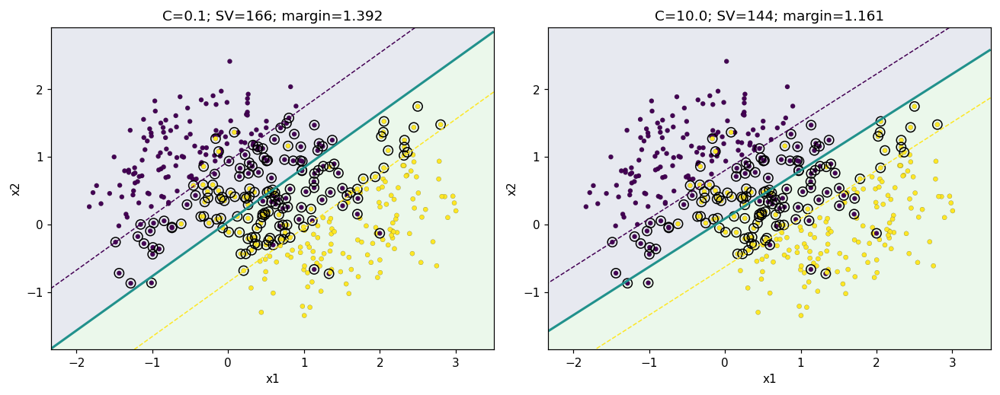

# 線形ソフトマージンSVMの実装と検証

直線では完全に分離できないデータを使い、ソフトマージンSVMを実装した学習記録です。スラック変数がヒンジ損失に対応することを確認し、SciPyのSLSQPで主問題と双対問題を個別に解きます。scikit-learnの線形 `SVC` で正則化パラメータ $C$ を変え、マージンと違反数を比較します。

[実行結果付きNotebook](notebooks/soft_margin_svm_study_lab.ipynb)

## スラック変数と双対問題

- $C>0$ のとき、最適なスラックは $\xi_k=\max(0,1-b_k g(x_k))$ です。 [ヒンジ損失の図](figures/hinge-loss.png)
- ラグランジュ関数をスラック変数で微分すると $C=\lambda_k+\gamma_k$ になり、双対係数に $0\leq\lambda_k\leq C$ の制約が入ります。
- $0<\lambda_k<C$ の点では $b_k g(x_k)=1$ となるため、この点を使ってバイアスを復元できます。2点だけの例では、双対の等式制約を保つSMOのペア更新も計算しています。

## 5点で主問題と双対問題を検算

1次元の5点には、同じ座標に正負のラベルが付いた点が含まれます。$C=1$ の場合、重みは $2/3$、バイアスは $-1/3$ でした。SLSQPの双対係数は線形 `SVC` の値と最大約 $1.10\times10^{-14}$ の差で一致しました。

主問題の解と双対係数を組み合わせてKKT条件を確認しました。目的値はともに約2.2222で、双対ギャップの絶対値は約 $6.13\times10^{-14}$ でした。

## 400点で $C$ の影響を比較

`make_moons` で生成した同じ400点で2つの線形 `SVC` を学習しました。教科書の実験とは $C$ の設定を揃え、座標はNotebookで生成しています。

| $C$ | サポートベクトル数 | マージン違反数 | 学習データの誤分類数 | マージン幅 $2/\lVert w\rVert$ |
| ---: | ---: | ---: | ---: | ---: |
| 0.1 | 166 | 163 | 67 | 1.3920 |
| 10 | 144 | 141 | 66 | 1.1606 |



このデータでは $C$ を大きくすると、マージン幅が狭まり、違反数も減りました。表の誤分類数は学習データで測った値です。

## 実行

Python 3.9.6、NumPy 2.0.2、SciPy 1.13.1、Matplotlib 3.9.4、scikit-learn 1.6.1で全11コードセルを順に実行しました。

```bash
cd machine-learning/soft-margin-svm
python3.9 -m venv .venv
source .venv/bin/activate
python -m pip install -r requirements.txt
python -m jupyter lab notebooks/soft_margin_svm_study_lab.ipynb
```

Notebookを上から実行してください。外部データは不要です。掲載時に図の見出し2つを英語にし、主問題の節の見出しをスラック変数を含む実装に合わせました。

マージン最大化の導出と、線形分離可能な例を確認できます。 [ハードマージンSVM](../linear-hard-margin-svm/README.md)

主問題と双対問題を別々に解く流れは、線形制約下の射影でも検算しています。 [凸二次計画](../../mathematics/convex-quadratic-programming/README.md)
