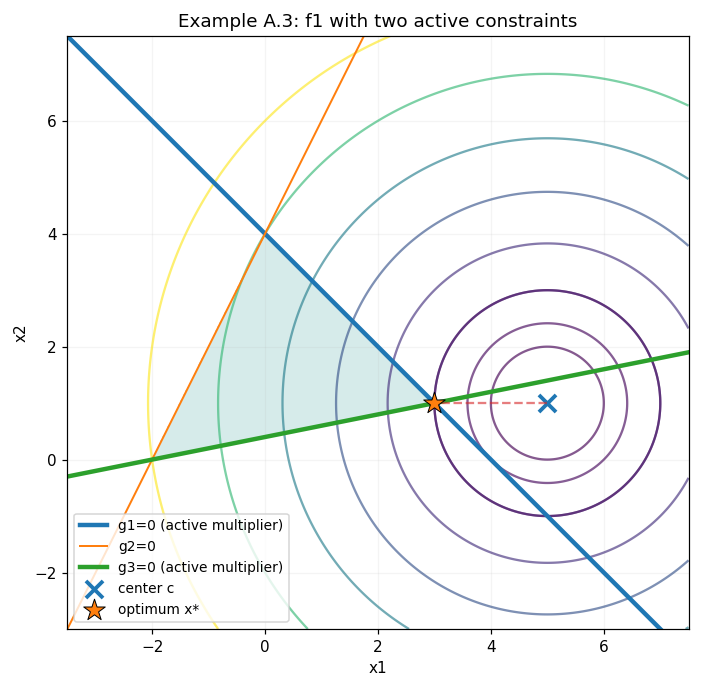

# 凸二次計画の実装と検証

3つの線形不等式で囲まれた領域に点を直交射影する問題を通じて、凸二次計画の主問題、双対問題、KKT条件を学んだ記録です。添付Notebookで扱う教科書の付録A.2、例題A.2・A.3をもとに、主問題と双対問題をSciPyのSLSQPで個別に解きます。

[実行結果付きNotebook](notebooks/convex_qp_kkt_duality_textbook_lab.ipynb)

## 実装と検算

中心を $c$、制約を $g(x)=a_0+Ax\leq 0$ とし、$f(x)=\tfrac12\|x-c\|^2$ を最小化します。最適解は、制約をすべて満たす点のうち $c$ に最も近い点です。

- 停留条件から $x=c-A^\top\lambda$ を導出し、双対目的関数を組み立てます。
- グラム行列 $H=AA^\top$ の半正定値性を式で示し、この例では階数が2であることを固有値とあわせて確認します。
- 双対解から復元した点を主問題の解と照合し、停留条件、主・双対実行可能性、相補性の4条件を検算します。
- 例題A.2では $\lambda=(t,0,0)$ の双対目的値を描き、主問題の最適値がその上限で、$t=1$ で一致する様子を確かめます。 [双対下界の図](figures/dual-lower-bound.png)

## 実験結果

同じ制約のもとで中心を変え、領域の辺、頂点、内部に解が来る場合を比較しました。

| 実験 | 中心 $c$ | 最適点 $x^*$ | 双対解 $\lambda^*$ | 最小値 |
| --- | --- | --- | --- | --- |
| 例題A.2 | $(2,4)$ | $(1,3)$ | $(1,0,0)$ | 1 |
| 例題A.3 $f_1$ | $(5,1)$ | $(3,1)$ | $(5/3,0,1/3)$ | 2 |
| 例題A.3 $f_2$ | $(1,1)$ | $(1,1)$ | $(0,0,0)$ | 0 |
| 自主実験 | $(4,0)$ | $(3,1)$ | $(2/3,0,1/3)$ | 1 |



例題A.2では第1制約、例題A.3の $f_1$ では第1・第3制約の乗数が正でした。$f_2$ では中心が領域の内部にあり、中心そのものが最適点です。 [辺への射影](figures/projection-edge.png) / [領域内に中心がある場合](figures/projection-interior.png)

4ケースともKKT条件の数値チェックを通過し、主・双対目的値の差の絶対値は最大で約 $2.78\times10^{-13}$ でした。正の乗数を持つ制約の等式から求めた解とも照合しました。

## 実行

Python 3.9.6、NumPy 2.0.2、SciPy 1.13.1、Matplotlib 3.9.4で全10コードセルを順に実行し、出力と図を再生成しました。リポジトリのルートから次の手順でNotebookを開けます。

```bash
cd mathematics/convex-quadratic-programming
python3.9 -m venv .venv
source .venv/bin/activate
python -m pip install -r requirements.txt
python -m jupyter lab notebooks/convex_qp_kkt_duality_textbook_lab.ipynb
```

カーネルを再起動し、全セルを上から実行してください。制約と中心はセル内で定義しています。最後の自主実験では `c_custom` を変えて、最適点や乗数の変化を確認できます。

線形SVMでも、停留条件を使って双対問題を導出し、双対解から主問題の変数を復元します。 [線形ハードマージンSVMの実装と検証](../../machine-learning/linear-hard-margin-svm/README.md)
