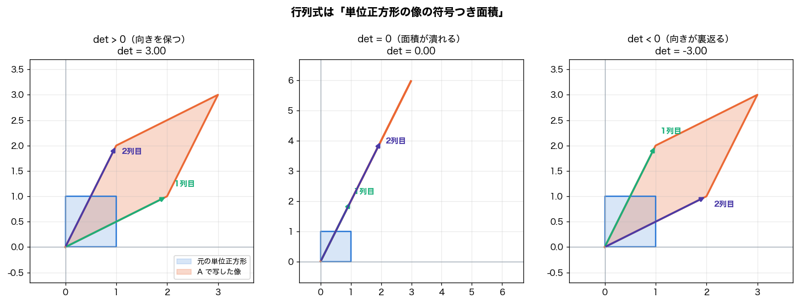
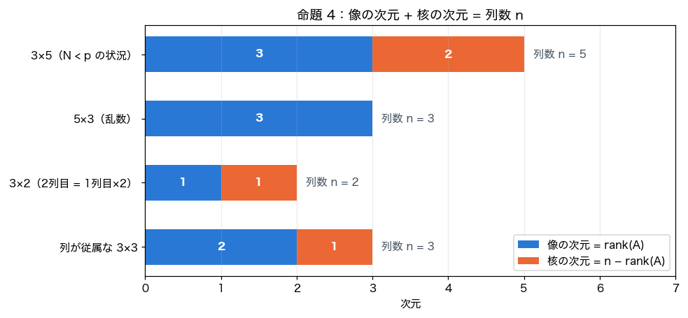
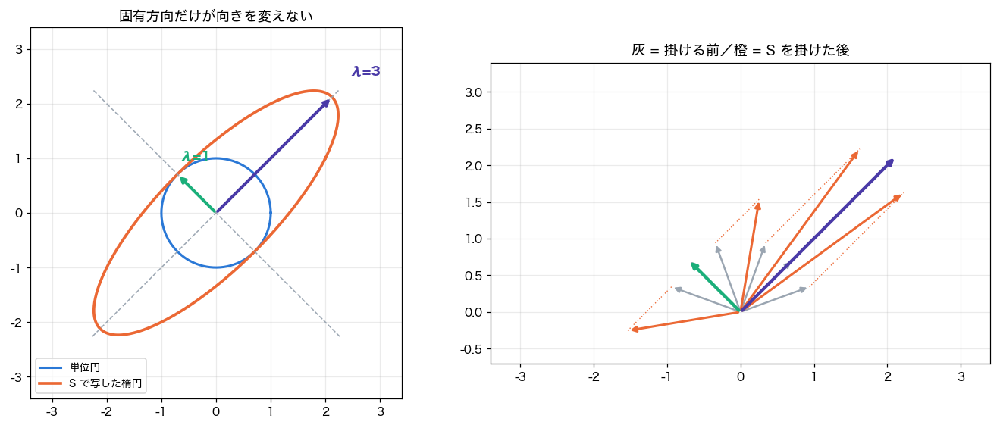
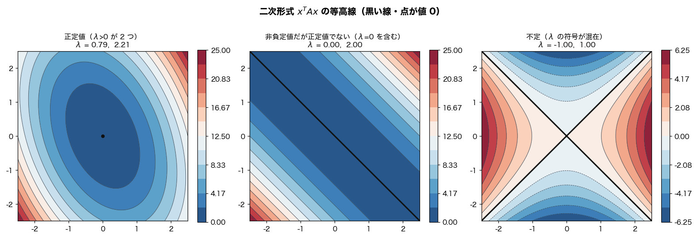

# 機械学習に必要な線形代数の実装と検算

『統計的機械学習の数理100問 with Python』の第0章を中心に、機械学習で使う線形代数をPythonで確かめた記録です。
掃き出し法とGram–Schmidt法を実装し、固有値分解・SVD・最小二乗解を数値で検算しました。
行列式、階数、固有方向、二次形式を図にし、回帰・Ridge・PCAにつながる性質も整理しています。

- **実装・数式・演習**：[Notebookを読む](notebooks/linear_algebra_for_machine_learning.ipynb)
- **使用技術**：Python / NumPy / pandas / Matplotlib
- **参考書**：鈴木讓 著『統計的機械学習の数理100問 with Python』共立出版、2020年。[出版社の書籍紹介](https://www.kyoritsu-pub.co.jp/book/b10003244.html)

## 学習の目的

1. 連立方程式・階数・逆行列を、行基本変形と対応づけて理解する。
2. 直交化・固有値分解・SVDを、元の定義式に代入して検算する。
3. 非負定値性と正定値性を区別し、回帰の解の一意性や正則化とのつながりを理解する。

本記録は第0章と補足のSVD・演習を対象としています。
Notebook内の「第2回」「第6回」「第13回」などは学習計画上の参照であり、この記録に他の回の実装を収録したものではありません。

## 実装と確認した内容

| テーマ | コードで取り組んだこと | 機械学習とのつながり |
| --- | --- | --- |
| 逆行列・階数 | 部分ピボット選択を含む掃き出し法`sweep`を実装し、`np.linalg.inv`と比較 | 回帰係数が一意に決まる条件 |
| 行列式 | 行列積・転置の性質と、Vandermonde行列の行列式を数値例で確認 | 多項式回帰の計画行列 |
| 一次独立・像・核 | 従属な列をもつ行列と長方形行列のrank・nullityを可視化 | 特徴量の重複、観測数より変数が多い場合 |
| 固有値・固有ベクトル | `eigh`の出力を`S @ v = λ * v`に代入して検算 | 対称行列とPCAの固有方向 |
| 正規直交基底 | `gram_schmidt`を実装し、`Q.T @ Q = I`と`Q @ R = A`を検算 | 射影とQR分解 |
| 非負定値性 | 固有値の符号と、二次形式の等高線・乱数点での値を比較 | 二乗誤差の形とRidge正則化 |
| SVD・擬似逆行列 | 従属列をもつ行列を復元し、特異値から作った擬似逆の解を`lstsq`と比較 | ノルム最小の最小二乗解 |

掃き出し法とGram–Schmidt法は手順を実装し、固有値・SVDなどはNumPyの分解ルーチンを使って性質を確かめています。
数値例での一致確認は、一般的な命題の証明とは区別します。

## 主な結果と可視化

### 行列式と階数を図で読む



単位正方形を行列で写し、正の行列式・ゼロ・負の行列式を比較しました。
図の3例では、順に面積をもつ像、線分に潰れた像、向きが反転した像になります。



`3×5`の乱数行列の例ではrankが3、nullityが2でした。
列数5に対して、出力に残る方向と核に入る方向を分けて考えることで、係数の非一意性との関係を整理しました。
棒グラフのnullityは`列数 − rank`で計算しています。掲載時には別途SVDで核の基底も作り、`A @ null_basis = 0`を確認しました。

### 固有方向と二次形式



実対称行列`[[2, 1], [1, 2]]`では、固有値1と3のそれぞれについて`S @ v`と`λ * v`が一致しました。
この正定値行列の例では、単位円が楕円に写り、固有値が半軸の長さに対応します。



正定値、非負定値だが正定値ではない行列、不定行列について、固有値と二次形式を比較しました。
乱数点の値は挙動を見るための例であり、すべてのベクトルに対する非負性はNotebook内の数式で説明しています。

### 分解と最小二乗解の検算

| 検証した例 | 結果 |
| --- | --- |
| 掃き出し法で求めた逆行列 | `np.linalg.inv`と一致し、元の行列との積は単位行列に一致 |
| Vandermonde行列 | 行列式と差の積がともに48 |
| Gram–Schmidt法 | `Q.T @ Q = I`、`Q @ R = A`を満たす |
| 一次従属な3本のベクトル | 第3列の処理で例外を出し、階数は2と確認 |
| SVDの例 | 従属列をもつ`6×3`行列のrankは2で、SVDから元の行列を復元できる |
| 最小二乗解 | 擬似逆からの係数と`lstsq`の係数が一致。約`[0.280433, -0.232975, 0.047458]` |
| 特徴量が重複した例 | `X.T @ X`の固有値は0と28。`0.5 I`を加えると0.5と28.5になる |

## 学習を通じて整理したこと

- **元の式で検算する。** 分解結果の値を眺めるだけでなく、復元や直交性の等式に戻って確認する。
- **符号の違いと誤りを区別する。** 固有ベクトルやQR分解の列の符号が違っても、定義式を満たしていればよい。
- **配列のshapeを意識する。** `(p,)`と`(p, 1)`の違いがブロードキャストによる意図しない計算を生む。
- **計算方法の役割を分ける。** 逆行列を作る練習と、連立方程式を直接解くこと、最小二乗解を求めることを区別する。
- **特異・非特異と正定値性をつなぐ。** 重複した特徴量と、対角成分への正則化の加算を同じ固有値の視点で捉える。

数学から機械学習へのつながりとして、[ポテンシャル関数法のデータ生成](../../machine-learning/potential-function-dual-perceptron/README.md)で使う共分散行列の正定値性も関連します。

## 実行方法

計算の動作確認環境はPython 3.9.6、NumPy 2.0.2、pandas 2.3.3、Matplotlib 3.9.4です。
リポジトリのルートから実行します。

```bash
python3 -m venv .venv
source .venv/bin/activate
python -m pip install -r mathematics/linear-algebra/requirements.txt
python -m jupyter lab mathematics/linear-algebra/notebooks/linear_algebra_for_machine_learning.ipynb
```

Windowsでは仮想環境の有効化に`.venv\Scripts\activate`を使用します。
カーネルを再起動して、上からすべてのセルを実行してください。外部データは不要です。
日本語フォントは環境にあるものを選ぶ設定です。候補がない場合は、日本語フォントを用意して冒頭セルの`font_candidates`へ名前を追加してください。
掲載した図はHiragino Sansを使って出力しています。

### 掲載時に確認した範囲

- 全11コードセルを新しいPythonプロセスで上から順に実行し、数値出力と4枚の図を再生成。
- `%matplotlib inline`はJupyter向けの表示指定として扱い、Pythonでの確認時だけ除外。
- 掃き出し法について、正則・特異・行交換が必要な行列・零行列のrankと入力を変更しないことを確認。
- QRの復元と直交性、一次従属時の例外、擬似逆の解、核の基底、実対称行列の対角化と`B.T @ B`による復元を追加検算。

JupyterLabの画面操作は検証対象に含めていません。

## 元Notebookからの補足・修正

元ファイルは`第1回_　線形代数.ipynb`です。数値例を生かして掲載用のファイル名と出力を整え、次を補足しました。

- 階数・退化次数定理の式は、定義域を`R^n`全体とする条件を明記。部分空間に制限する場合との違いも補足。
- 実対称行列の対角化の説明を修正し、実固有値・複素固有値の固有空間と、完全形・縮約形SVDのshapeを区別。
- 拡大行列`[A | I]`と係数行列`A`の階数を区別するよう、逆行列の例を補足。
- 楕円の「軸」と「半軸」の表現、共分散の分母、誤字を修正。
- 日本語フォントの自動選択と、変換後の図全体が見える表示範囲を追加。二次形式の零集合も明示し、書誌情報と実行出力を更新。

## 限界と次に取り組みたいこと

掃き出し法とGram–Schmidt法は学習用の実装です。ゼロ・一次従属の判定には固定の絶対閾値を使っており、行列のスケールや悪条件性に対する頑健性までは検証していません。
SVDで擬似逆を作る例も、特異値の打ち切りに固定閾値を用いています。

次は、ほぼ一次従属な特徴量や条件数の大きい行列で、`solve`・QR・SVDによる解の違いを比較し、回帰・Ridge・PCAへつなげたいと考えています。

正則化への具体的なつながりは、[Ridge・Lassoの学習記録](../../machine-learning/regularization/README.md)にまとめています。固有値への`Nλ`の加算、係数の縮小、予測誤差の比較を扱っています。

## 参考資料

- 鈴木讓 著『統計的機械学習の数理100問 with Python』共立出版、2020年。ISBN: 9784320125070。[出版社の書籍紹介](https://www.kyoritsu-pub.co.jp/book/b10003244.html)
- [NumPy：SVDの形状と復元](https://numpy.org/doc/stable/reference/generated/numpy.linalg.svd.html)
- [SciPy：実Schur分解と複素Schur分解の違い](https://docs.scipy.org/doc/scipy/reference/generated/scipy.linalg.schur.html)

章節・命題・ページ番号は元Notebookの学習時の参照記録をもとにしています。

[数学の一覧へ](../README.md) / [リポジトリのトップへ](../../README.md)
