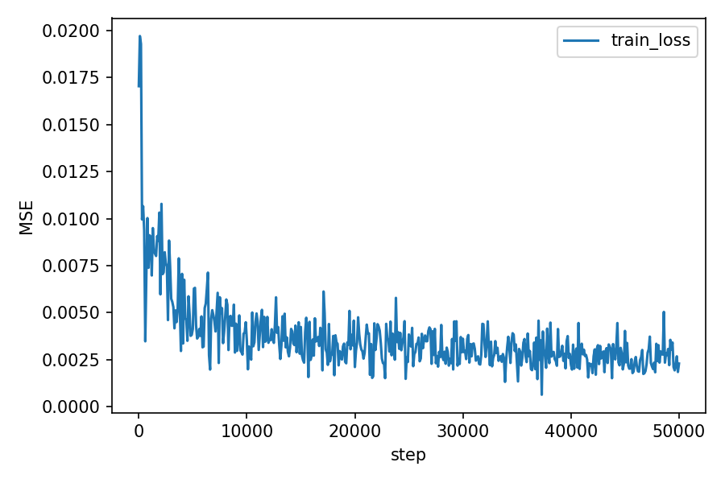
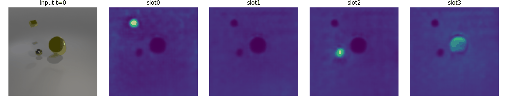

# 世界モデル2025：物体中心表現と意味・位置分離の実装・評価

世界モデル2025の最終課題として、動画中の物体を時間方向に同じ対象として扱うための表現を検討したプロジェクトです。
Slot AttentionからSAVi型の動画モデルへ拡張し、さらにスロット表現を意味（identityを担わせたい成分）と位置（pose）に分けるモデルを実装しました。

**この記録で見てほしいこと**は、モデルを段階的に実装し、再構成の見た目だけでなく、追跡指標と評価方法まで検討した点です。
意味・位置の分離は設計上の狙いであり、独立した意味表現が獲得されたことや、長期記憶の改善を実証したとまでは結論づけていません。

- **実装**：[Slot Attention](notebooks/SlotAttention_MOVi_A.ipynb) / [SAVi型ベースライン](notebooks/SAVi_MOVi_A_baseline.ipynb) / [意味・位置分離モデル](notebooks/SAVi_MOVi_A_disentangled.ipynb)
- **使用技術**：Python / PyTorch / TensorFlow Datasets / NumPy / SciPy / Matplotlib
- **元の成果物**：[Worldmodel2025_final](https://github.com/Yoshiharu23/Worldmodel2025_final)
- **再現方法と制約**：[REPRODUCIBILITY.md](REPRODUCIBILITY.md)
- **取り込み元とファイルの対応**：[SOURCE.md](SOURCE.md)

## 課題とアプローチ

動画で物体の位置や見た目が変化しても、同じ物体を同じスロットで表現できるようにしたいと考え、次の3段階で実装を進めました。

| 段階 | 実装内容 | 確認したいこと |
| --- | --- | --- |
| Slot Attention | 各フレームを複数のスロットに分解し、RGBとマスクから再構成 | 静止画としての分解・再構成と、動画に適用したときの追跡 |
| SAVi型ベースライン | 前フレームのスロットを予測し、現在フレームの特徴で補正 | 時間方向にスロットを引き継ぐ効果 |
| 意味・位置分離 | スロットから意味成分と4次元の位置成分を作り、別デコーダで再構成 | 表現を分ける設計による挙動の変化 |

SAVi型モデルは、Predict→Correctの構造を学ぶための再構成損失中心の実装です。
元論文の光流予測や初期状態の条件づけまで揃えた完全な追試ではありません。

## 実装で取り組んだこと

### データ処理と学習の記録

- MOVi-Aの動画とインスタンスマスクをTFDSから読み込み、PyTorchのDataLoaderへ変換。
- 静止画モデルではフレームをキャッシュし、動画モデルでは連続フレームを切り出す構成を実装。
- 学習率のウォームアップ、学習ログ、チェックポイント、固定バッチの再構成図を保存。

### 意味・位置に分けるモデル

`SlotToMeaningPose`で64次元のスロットから、標準設定では60次元の意味成分と4次元の位置成分を作ります。
位置成分は平行移動とスケールに対応する `(tx, ty, log_sx, log_sy)` とし、`affine_grid`でデコーダに座標を渡します。
意味成分には時間方向のEMAを入れ、再構成損失に位置の滑らかさ・大きさの正則化と、バッチ内で成分を入れ替えるswap consistency損失を加えています。

ここでのEMAはクリップ内で意味成分を平滑化する処理です。外部メモリの読み書き機構を追加したものではありません。

### 評価と可視化

- 再構成画像とスロットごとのマスクを可視化。
- Hungarian割当を用いたフレーム間の対応づけを実装。
- ID swap率、マスクの時間的整合性、FG-ARI、GTとのIoUなどの評価コードを用意。
- 遮蔽後の再同定と、観測を止めた後のロールアウトを評価するコードを実装。

## 保存済みの結果から確認できること

以下は[静止画Slot Attentionの保存CSV](results/slot-attention/video_eval_summary.csv)から再集計した値です。
新たに学習や推論を実行して得た結果ではありません。

| 項目 | 保存ログからの値 |
| --- | ---: |
| 評価動画数 | 64 |
| 動画ごとのID swap率の単純平均 | 0.2148 |
| 全動画のswap総数 ÷ 対象遷移総数 | 0.2406 |
| 動画ごとのconsistency IoUの単純平均 | 0.8713 |
| 学習ログの最終ステップ | 50,000 |
| 最終ステップの学習loss | 0.002295 |

集計結果の機械可読データは[summary.json](results/summary.json)、集計処理は[summarize_results.py](scripts/summarize_results.py)にあります。
動画長や可視物体数により対象遷移数が違うため、動画単位の平均と全遷移をまとめた割合は一致しません。

この静止画モデルのID swap率は、IoUで追跡した後の「GT物体に対する優勢スロット」の変化を数えています。
consistency IoUは、追跡後の同じスロットについて連続フレーム間のsoft IoUを平均した指標です。
**GTに対するセグメンテーションIoUではありません。** 高い時間的整合性だけで、物体を正しく分離できたとは判断できません。

### 再構成と追跡の可視化

以下は静止画Slot Attentionの学習前と50,000ステップ後の保存図です。SAVi型モデル・分離モデルの図ではありません。

| 学習前 | 50,000ステップ後 |
| --- | --- |
| [入力・再構成・スロットの図](figures/recon_step000000.png) | [入力・再構成・スロットの図](figures/recon_step050000.png) |



以下は、静止画モデルを各フレームに適用し、IoUで対応づけた追跡の例です。



動画ごとの分布は[swap率](figures/hist_swap_rate.png)・[consistency IoU](figures/hist_consistency_iou.png)・[両指標の散布図](figures/scatter_swap_vs_consistency.png)で確認できます。

### 元リポジトリで報告したSAVi比較

元READMEには、次の比較値を記載しています。取り込み対象のNotebookは出力が保存されておらず、この表に対応する評価CSVも確認できないため、**元READMEでの報告値**として掲載します。

| 元READMEの評価区分 | モデル | ID swap（平均）↓ | matched IoU（平均）↑ |
| --- | --- | ---: | ---: |
| 通常評価 | Baseline | 0.3789 | 0.1667 |
| 通常評価 | Disentangled | 0.0567 | 0.5683 |
| 20バッチ評価 | Baseline | 0.3525 | 0.1645 |
| 20バッチ評価 | Disentangled | 0.0185 | 0.6759 |

出典：[元READMEの比較表](https://github.com/Yoshiharu23/Worldmodel2025_final/blob/77df2fb7595bb1a09101b979f974235766b02b33/README.md)。

SAVi側の追跡コードは、GTを使わず、隣接フレームのハードマスクをHungarian割当で対応づけます。
その対応が同じスロット番号からずれる割合をID swapとし、対応後のIoUも計算しています。
先ほどの静止画Slot Attentionの指標とは定義が異なるため、数値を横並びにして優劣を比較できません。
また、通常評価のバッチ数や、報告値を出した際の関数定義・面積閾値は保存資料だけでは確定できません。

## 学習を通じて整理したこと

- **再構成・分割・追跡は別々に確かめる必要がある。** 再構成lossの低下や時間的に安定したマスクだけでは、正しい物体表現を得たことの証明にはならない。
- **表現の設計と、その性質の実証を分ける。** 意味・位置の分岐を用意することに加え、入れ替え実験やアブレーションで各成分の役割を確認したい。
- **指標名だけで比較しない。** GTの使用有無、対応づけ、空スロットの扱い、平均の取り方まで揃える必要がある。
- **実験結果と設定を一緒に保存する。** 比較値に対応するチェックポイント・評価コード・実行環境・生の評価ログを紐づけることが再現性につながる。

## 限界と次に取り組みたいこと

1. **比較実験の記録を揃える。** 同じsplit・前処理・評価定義・乱数条件でSAVi型ベースラインと分離モデルを再評価し、複数seedと生の評価CSVを保存する。
2. **長期記憶の検証対象を明確にする。** 分離モデルの長期評価セルは`model.base`を使うため、意味・位置分離デコーダやEMAの効果を直接測っていない。評価を拡張し、遮蔽イベント数も記録する。
3. **欠損した評価ログを補う。** 保存済み`metrics.csv`の`val_loss`には有限値がなく、検証lossの改善は確認できない。
4. **実験用コードを整理する。** 同名の評価関数の再定義と出力キーの違いを解消し、データ処理・モデル・学習・評価を分離する。

今回のLearningへの整理では、元Notebookのコードをそのまま保存し、JSONとコードセルの構文確認、保存CSVの再集計、出典ファイルとの一致確認を行いました。
GPU学習、MOVi-Aの取得、チェックポイントからの再評価は実施していません。

## ファイル構成

```text
world-model-2025/
├── README.md
├── REPRODUCIBILITY.md
├── SOURCE.md
├── notebooks/                 # 元の3つのNotebook
├── figures/                   # 主要な保存図・追跡GIF
├── results/
│   ├── slot-attention/        # config.json・学習CSV・動画別評価CSV
│   └── summary.json           # 保存CSVから再集計した値
└── scripts/
    └── summarize_results.py   # Python標準ライブラリで動く集計処理
```

## 参考資料

- Locatello et al., [Object-Centric Learning with Slot Attention](https://arxiv.org/abs/2006.15055), NeurIPS 2020.
- Kipf et al., [Conditional Object-Centric Learning from Video](https://arxiv.org/abs/2111.12594), ICLR 2022.
- [Kubric：データ生成とMOViデータセット](https://github.com/google-research/kubric)
- [元の実装・実験リポジトリ](https://github.com/Yoshiharu23/Worldmodel2025_final/tree/77df2fb7595bb1a09101b979f974235766b02b33)

[プロジェクト一覧へ](../README.md) / [機械学習の一覧へ](../../machine-learning/README.md) / [リポジトリのトップへ](../../README.md)
