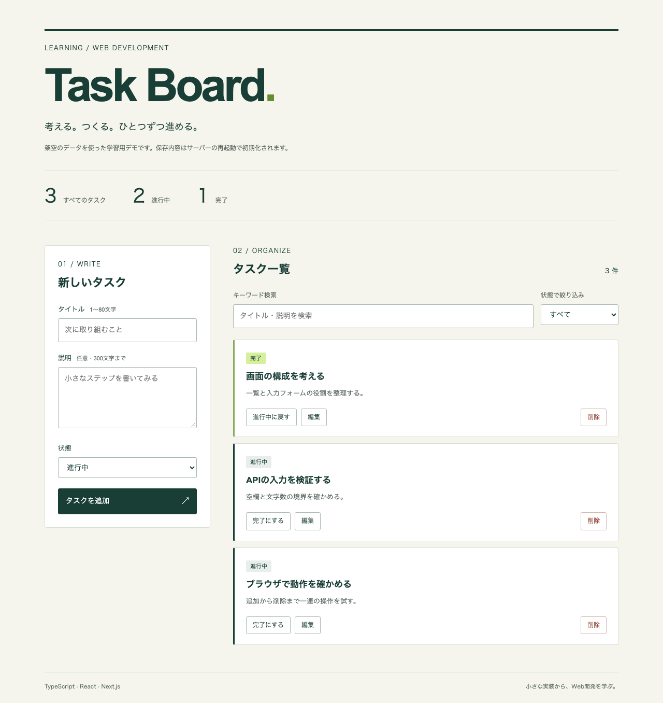

# Webアプリケーション開発

TypeScript・React・Next.jsを使ったWebアプリケーション開発の学習記録です。画面を作ることに加え、API、データの検証、権限管理、テスト、開発手順までを学びました。

実際の開発内容をもとに、サービス名・利用目的・利用者情報・画面・接続先を公開用に置き換えています。ここでは、学んだ技術の説明と、小さく作り直した架空のタスク管理アプリを掲載しています。個別機能の担当範囲や、本番運用の実績を網羅するものではありません。

## この記録で伝えたいこと

- 画面をコンポーネントに分け、フォーム・一覧・検索・操作結果を実装する。
- TypeScriptでデータの型を定義し、APIが受け取る値を実行時にも検証する。
- 認証と認可を分けて考え、画面・サーバー・DBの責務を整理する。
- 単体テストとブラウザテストを使い、変更後の動作を確かめる。
- ブランチ・PR・CIを使って、変更内容と検証結果を共有する。

## 学んだ内容と公開サンプルの対応

| 領域 | 実際の開発で学んだこと | 公開サンプルで確認できること |
| --- | --- | --- |
| フロントエンド | Reactのコンポーネント、フォーム、画面の状態、CSSによるレイアウト | タスク一覧、検索・状態別表示、編集フォーム、通信中・エラー・空の表示 |
| サーバー | Next.jsのRoute Handler、HTTP、入力検証、処理結果の返却 | GET・POST・PATCH・DELETEによるCRUDと、400・404のエラー応答 |
| データ | PostgreSQLの制約、データモデル、永続化と更新処理 | 型定義と入力検証。保存先は動作確認用のプロセスメモリに簡略化 |
| 認証・認可 | Supabase Auth、サーバー側の権限判定、RLSを使ったアクセス制御 | [設計ノート](docs/design.md)で考え方を整理。サンプルにログイン・権限制御は実装していない |
| 品質 | 型検査、単体・統合・E2Eテスト、GitHub Actionsによる自動検証 | 型検査、ビルド、入力検証の単体テスト、CRUDのブラウザテスト |
| 開発・配置 | Issue・PRでの変更管理、環境変数、検証環境と本番環境の分離 | ローカルで再現する手順と、依存バージョンを固定したlockfile |

## 試せるアプリ：Task Board

架空のタスクを登録・編集・完了・削除し、キーワードと状態で絞り込めます。初期データはすべて公開用に作ったものです。元のアプリのデータ・文面・画像・業務固有のルールを流用していません。



```text
web-development/
├── README.md
├── docs/
│   └── design.md             # 構成・学び・公開用の変更点
├── figures/
│   └── task-board.png         # 公開用サンプルの画面
└── demo/
    ├── package.json
    ├── package-lock.json
    ├── src/
    │   ├── app/              # ページ・API・CSS
    │   ├── components/       # フォームと一覧
    │   └── lib/              # 型・入力検証・メモリ保存
    └── tests/                # 単体テストとブラウザテスト
```

### 実行方法

Node.js 24以上27未満・npm 11系で実行します（`.node-version`は24）。リポジトリのルートから実行します。外部サービスのアカウントや環境変数は不要です。

```bash
cd software-development/web-development/demo
npm ci
npm run dev
```

[http://127.0.0.1:3000](http://127.0.0.1:3000) を開いて操作します。初期タスクの編集、追加、完了状態の切り替え、検索、削除を試せます。

保存先は起動したサーバープロセス内のメモリです。再起動や開発中の再読み込みで初期化される場合があり、複数プロセス間では共有されません。ログイン機能はなく、アクセスした人が同じデータを操作するローカル学習用サンプルです。

### 検証方法

```bash
npm run typecheck
npm test
npm run build
npx playwright install chromium
npm run test:e2e
```

ブラウザテストは専用ポートで本番ビルドを起動します。テストの前に`npm run build`を実行してください。

2026年11月21日にNode.js 26.0.0・npm 11.12.1で型検査・ビルド・単体テスト7件・ブラウザテスト6件の成功を確認しました。ブラウザテストでは、PCとスマートフォンの画面幅でCRUD・検索、APIの不正入力、保存失敗後の入力保持と再送信を確認しています。

## 学習を通じて意識するようになったこと

型が付いていることと、外部から届いた値が正しいことは別です。サンプルでは`unknown`で受け取ったJSONを検証してから保存し、エラーをフォームへ返しています。

また、UI・通信・データのルールを分けると、画面を立ち上げずに検証できる部分が増えます。一方、追加から削除までの操作はブラウザでも確かめ、各部分をつないだときの動作を確認します。

認証・認可、DBへの保存、外部APIとの接続を加える場合に必要な責務は、[設計ノート](docs/design.md)にまとめています。

## 参考資料

- [Next.js：App Router](https://nextjs.org/docs/app)
- [React：Managing State](https://react.dev/learn/managing-state)
- [TypeScript：Narrowing](https://www.typescriptlang.org/docs/handbook/2/narrowing.html)
- [Supabase：Row Level Security](https://supabase.com/docs/guides/database/postgres/row-level-security)
- [Playwright：Writing tests](https://playwright.dev/docs/writing-tests)
